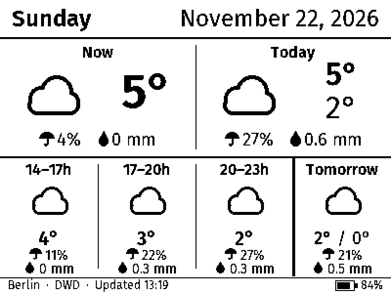
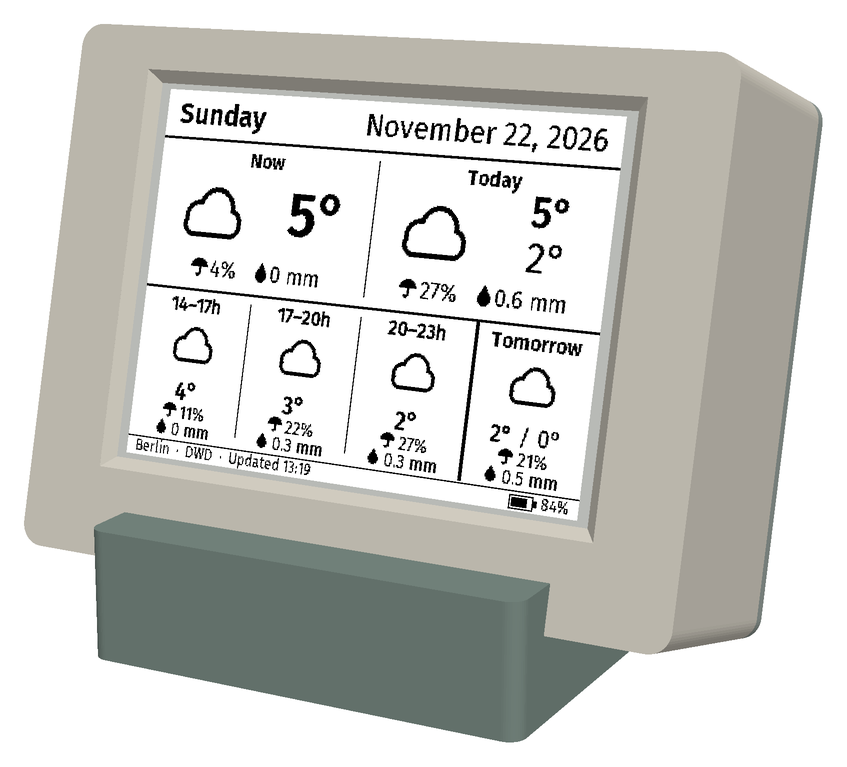
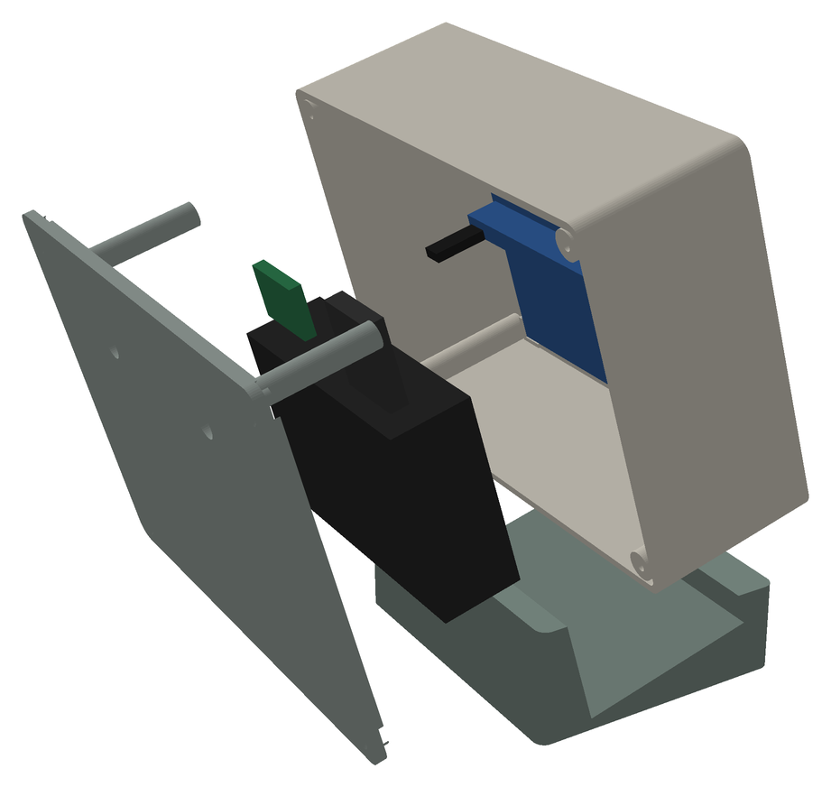

# E-Ink Weather Dashboard

A battery-powered 4.2″ e-paper weather station. A Raspberry Pi fetches the forecast and draws
the whole screen; a tiny XIAO ESP32-C6 wakes up every half hour, downloads the finished
picture, puts it on the panel and goes back to sleep. Months on three AA cells, no API keys,
and a 3D-printable case.

<p align="center">
  
</p>

<p align="center">
  
  
</p>

## Features

- **Everything at a glance:** now, today (high/low), the next 3 × 3 hours and tomorrow, each
  with rain probability ☂ and expected amount 💧
- **Real measurements where available:** in Germany the current values come from the nearest
  [DWD](https://www.dwd.de) station; worldwide it falls back to [Open-Meteo](https://open-meteo.com)
- **Set your town by name:** `place = "Hamburg"` is all the location config you need
- **Low power:** the ESP32 is awake for about 10 s per update; the panel keeps its picture
  without power
- **No reflashing for changes:** layout, language, fonts and refresh interval live on the Pi.
  Preview the screen in any browser
- **English or German** display text, switchable with one click on the Pi's preview page
- **3D-printable case** with battery cradle, wall keyholes and a removable desk stand
  (parametric, regenerate it for your parts)

## How it works

```
DWD / Open-Meteo ──(≤ every 10 min)──► Raspberry Pi ──WiFi/HTTP──► XIAO ESP32-C6 ──SPI──► e-paper
 free, no key                           server/          15 kB       firmware/              400×300 b/w
                                        fetch, summarise,  1-bit      wake, download,
                                        RENDER the frame   bitmap     display, deep sleep
```

The Pi does all the work, so the microcontroller stays awake as briefly as possible. The
server also tells the ESP32 how long to sleep (`X-Sleep-Seconds`), which keeps updates aligned
to :00 and :30 without clock drift.

## What the screen shows

| Area | Content |
|---|---|
| **Header** | Weekday and date |
| **Now** | Current conditions: icon, temperature, rain probability for this hour, rain in the last hour |
| **Today** | High (bold) above low, for the whole day. Icon, rain probability and amount for the **rest** of the day |
| **3 × 3 h** | Rolling blocks from the next full hour (at 10:05 → 11–14, 14–17, 17–20): average temperature, highest probability, total amount, most significant weather. Night hours get a moon |
| **Tomorrow** | High / low, rain probability and amount, icon for the day |
| **Footer** | Place, data source, update time, battery % (or a plug on USB), and "DATA OUTDATED" if no weather service was reachable for 2 h |

**Icons that agree with the numbers.** A forecast hour only gets a rain or snow icon if
probability *and* expected amount support it: never below 15 %, always from 1 mm (showers),
otherwise at least 30 % with at least 0.1 mm, or at least 60 % even for a trace. A
thunderstorm needs 30 %. Over several hours the most significant weather wins: storm > snow >
rain > drizzle > fog > cloud > sun. See `icon_code()` in `server/weather.py`.

## Weather data

| | DWD via [Bright Sky](https://brightsky.dev) (`provider = "dwd"`) | [Open-Meteo](https://open-meteo.com) (`provider = "openmeteo"`) |
|---|---|---|
| Now | **Measured** at the nearest DWD station, every 10 min | Model value |
| Forecast | MOSMIX, the DWD's statistically corrected point forecast | Weather models (ICON, ECMWF, …) |
| Coverage | Germany and border regions | Worldwide |

Both are free and need no key. If the preferred provider fails (for example DWD outside
Germany), the server uses the other one automatically and the footer says which. Outside
Germany, set `provider = "openmeteo"`.

---

## Parts

| Part | Notes |
|---|---|
| Raspberry Pi (any model with WiFi or LAN) | Runs the server; can share the Pi with other services |
| Seeed Studio **XIAO ESP32-C6** | Deep sleep about 15 µA |
| Waveshare **Pico-ePaper-4.2** (V2, black/white) or the 4.2″ e-Paper Module | 400 × 300, SSD1683, driven with GxEPD2. Use the 8-pin cable |
| Pololu **S7V8F3** 3.3 V step-up/step-down | Stable 3.3 V over the whole battery range |
| 3 × AA holder + 3 × NiMH cells | About 68 × 49 × 20 mm holder (the case is sized for it) |
| 2 × 1 MΩ resistor, 1 × 100 nF ceramic capacitor | Battery voltage divider |
| Dupont jumper wires | Female ends for the XIAO and Pololu pins, male ends for the e-paper board's Pico header |

## Wiring

**Display to XIAO** (8-pin cable):

| E-paper | XIAO | | E-paper | XIAO |
|---|---|---|---|---|
| VCC (grey) | **3V3** | | CS (orange) | D1 |
| GND (brown) | GND | | DC (green) | D3 |
| DIN (blue) | D10 | | RST (white) | D4 |
| CLK (yellow) | D8 | | BUSY (purple) | D5 |

**Battery** (only three solder joints, all in a small harness at the battery holder):

```
3×AA + ──┬───────────────► Pololu VIN
         1M                 Pololu VOUT (3.3 V) ──► Pico header pin 39 (VSYS) on the e-paper board
         ├──┬──────────────► XIAO D0 (A0)
         1M 100nF           Pololu GND ───────────► Pico header GND (e.g. pin 38)
3×AA − ──┴──┴──────────────► Pololu GND             SHDN: unconnected
                            8-pin cable ══► XIAO: the grey VCC wire now powers the XIAO's 3V3
```

- The Pico-ePaper board routes its VSYS pin to the 8-pin VCC (VCC jumper on **VSYS**, the
  default), so the regulator feeds display and XIAO without touching the XIAO's pins.
- **Leave the XIAO's 5V pin unused.** It is the USB input: fed from a battery, the charger
  looks for a LiPo and the red charge LED blinks forever, draining the cells.
- ⚠️ **Never connect USB and the battery at the same time.** Remove the cells before flashing.
- Use a ceramic "104" capacitor, not an electrolytic one (its leakage would swamp the 2 µA
  divider). 5-band 1 MΩ resistors read brown-black-black-**yellow**-brown.
- No multimeter? `firmware/pololu_test` turns the XIAO into a voltmeter to check the regulator.

**Battery level is counted, not guessed from the voltage.** NiMH cells stay on a flat plateau
for most of their life (50–80 mV per cell between full and half empty, less than the ESP32's
ADC error), so the ESP32 reports how long it was awake, failed WiFi attempts included, and the
Pi adds the sleep current: `level = 1 − used mAh / capacity`. The voltage only guards the very
end and detects fresh cells; the preview page also has a *New batteries inserted* button and
shows mAh per day, days left and the WiFi signal.

**Battery life** (measured): about 10 mAh per day with 48 updates, so **3 × 1900 mAh NiMH last
about 6 months**. A static IP (`config.h`) saves another second of WiFi per wake-up.

---

## Case (3D print)

`enclosure/case.py` is a parametric model (Python + [manifold3d](https://pypi.org/project/manifold3d/)).
The printable files are in [`enclosure/stl/`](enclosure/stl) (GitHub shows them in 3D):

| Part | Size | Print orientation |
|---|---|---|
| [`case_front.stl`](enclosure/stl/case_front.stl) | 121.5 × 92.5 × 42.5 mm, window 88.5 × 65.5 mm, 45° chamfer | face down |
| [`case_lid.stl`](enclosure/stl/case_lid.stl) | battery cradle, 3 hold-down posts, 2 keyholes | outside down |
| [`case_stand.stl`](enclosure/stl/case_stand.stl) | 80 × 67 × 30 mm, leans the case back 15°, removable | flat |

- Outside 121.5 × 92.5 × 45 mm; battery, regulator and XIAO all sit behind the display.
- No supports needed. PLA or PETG, 0.2 mm layers, 3 walls, 15 % infill, about 100 g in total.
- Extras: 4 countersunk screws 2.9 × 9.5 mm (or M3 × 10 self-tapping), 3 foam pads (~3 mm)
  on the lid posts, some velcro for the battery holder, XIAO and regulator.
- Plastic, not metal: the XIAO's antenna is inside.

The window position, standoff height and battery holder size at the top of `case.py` are
measured from the parts above. For your own parts:

```bash
pip install manifold3d numpy
python3 enclosure/case.py            # writes enclosure/stl/*.stl
python3 enclosure/render_images.py   # optional: the pictures in docs/
```

Tip: print only the first 3 mm of the front first to check that the window sits over the picture.

---

## Setup

### 1. Server on the Raspberry Pi

The server runs in its own virtualenv and doesn't touch the system Python or other services.

```bash
sudo apt install -y python3-venv
git clone https://github.com/a-h-85/eink-weather-dashboard.git ~/eink-weather-dashboard
cd ~/eink-weather-dashboard
python3 -m venv venv
venv/bin/pip install --only-binary=:all: "pillow<12" tomli   # tomli only needed on Python < 3.11
cd server && cp config.example.toml config.toml && nano config.toml
```

Set your town and test:

```toml
[location]
place = "Hamburg"          # that's it; `python3 server.py --find "Springfield"` if ambiguous
```

```bash
../venv/bin/python server.py
```

Open `http://<pi-ip>:8080/` to see the screen exactly as the e-paper will show it. Then
install the service (edit the paths in the file if your user isn't `pi`):

```bash
sudo cp eink-dash.service /etc/systemd/system/ && sudo systemctl enable --now eink-dash
```

Give the Pi a fixed IP (DHCP reservation in your router), because the ESP32 connects by IP.

### 2. Firmware on the XIAO ESP32-C6

1. Arduino IDE → Boards Manager → **esp32 by Espressif** (≥ 3.0) → board **XIAO_ESP32C6**
2. Library Manager → **GxEPD2** (pulls in Adafruit GFX)
3. Copy `firmware/eink_dashboard/secrets.example.h` to `secrets.h` (git-ignored) and enter
   your WiFi (2.4 GHz) and the Pi's address and port
4. Flash. To flash again later, hold **BOOT** while plugging in USB, then press **RESET**
   after the upload

Or from the command line:

```bash
arduino-cli compile --upload -p /dev/cu.usbmodem* --fqbn esp32:esp32:XIAO_ESP32C6 firmware/eink_dashboard
```

Tested with esp32 core 3.3.12, GxEPD2 1.6.5, Adafruit GFX 1.12.3. For a Waveshare 4.2″ **V1**
use the `GxEPD2_420` driver class in the sketch.

## Configuration

`server/config.toml`:

| Section | Key | Meaning |
|---|---|---|
| `location` | `place` | Town name, looked up once and cached. Optional `country = "DE"`, `name` for the footer, or `latitude`/`longitude`/`timezone` to skip the lookup |
| `weather` | `provider` | `"dwd"` (Germany) or `"openmeteo"` (worldwide); the other one is the fallback |
| `display` | `language`, `refresh_minutes` | `"en"` or `"de"` (default; the preview page can switch it); update interval, aligned to the clock |
| `server` | `host`, `port` | Where the server listens |
| `battery` | `type`, `cells`, `capacity_mah` | `"nimh"` counts the charge used (see below); `"linear"` maps `empty_mv`…`full_mv` (Li-ion, alkaline) |

Endpoints: `/` preview page with an **English / Deutsch** switch (saved on the Pi, used from the next update), `/preview.png`, `/display.bin` (for the ESP32), `/api/weather` (JSON).

## Customizing

- **Layout:** `server/render.py`, all coordinates for 400 × 300. Preview with
  `python3 server/server.py --render out.png` on any computer
- **Icons:** `server/icons.py`, drawn with Pillow shapes (no image files)
- **Fonts:** Fira Sans is bundled in `server/fonts/`; it stays crisp in 1-bit down to 12 px
- **Rain icon thresholds:** constants at the top of `icon_code()` in `server/weather.py`

## Troubleshooting

| Problem | Likely cause |
|---|---|
| Display stays white or shows noise | Wrong driver (V1 vs V2), swapped DIN/CLK, or BUSY not connected |
| Display never updates | Wrong Pi address/port in `secrets.h`, or the service isn't running: `curl -I http://<pi>:8080/display.bin` |
| Plug icon although on battery | The divider doesn't reach D0 (check the 1 MΩ colour bands and the joints) |
| Red LED blinks on battery | Battery is on the XIAO's 5V pin; feed the 3.3 V into the display board's VSYS instead |
| "DATA OUTDATED" | The Pi can't reach api.brightsky.dev or api.open-meteo.com |

## Credits and license

- Weather data: [Deutscher Wetterdienst](https://www.dwd.de) (CC BY 4.0) via [Bright Sky](https://brightsky.dev),
  and [Open-Meteo](https://open-meteo.com) (CC BY 4.0); geocoding by Open-Meteo
- Display driver: [GxEPD2](https://github.com/ZinggJM/GxEPD2)
- Font: [Fira Sans](https://github.com/mozilla/Fira), SIL Open Font License 1.1 (`server/fonts/OFL.txt`)
- Code, case and docs: MIT License, see [LICENSE](LICENSE)
